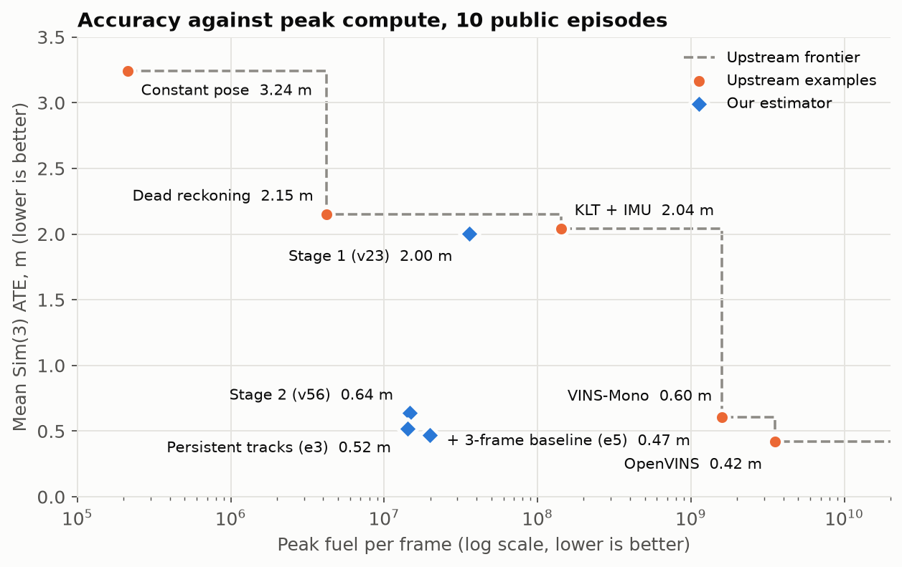
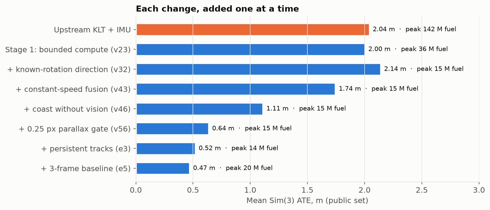
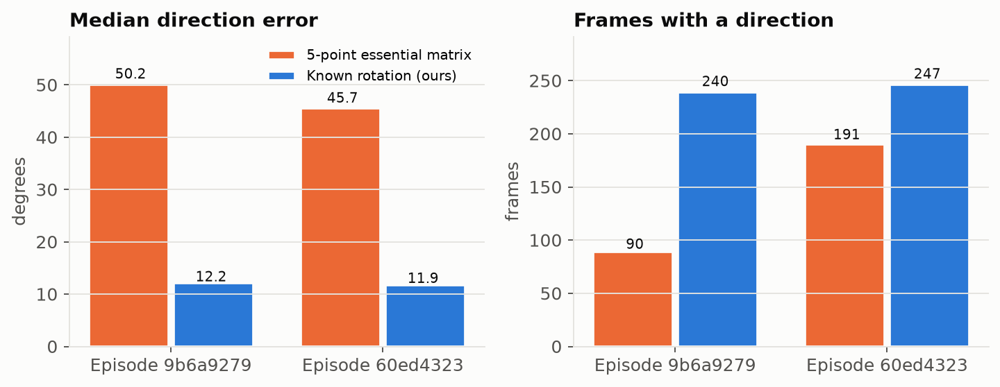
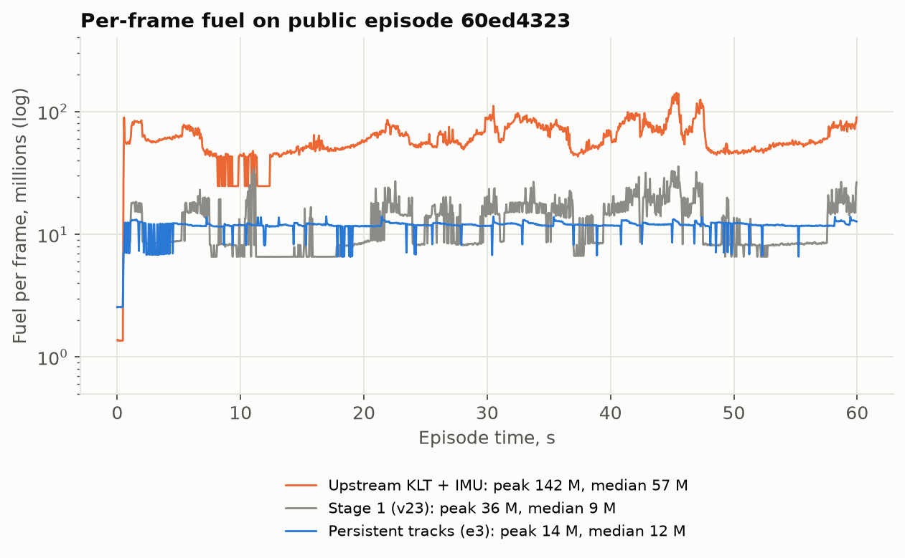
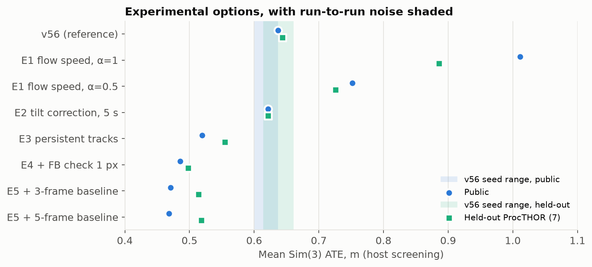
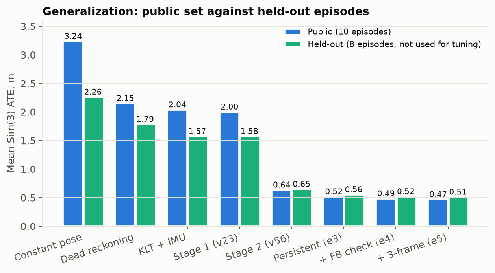

# Project 3: Compute-Efficient Visual-Inertial Odometry

Problem, related work, methods and results. EECS 116/216, November 2026. This is the repository copy of the project write-up; the code is in `solutions/klt_bounded/` and the recorded results are in `results/klt-bounded/`.

## Problem statement

We are building a visual-inertial odometry (VIO) estimator for the VIOBench quadrotor benchmark. Each frame it receives a 320 × 240 RGB image and the IMU samples since the last frame, and returns the camera's pose and twist relative to its first frame; estimates are causal and final. Intrinsics vary per episode, the IMU has noise and drifting biases, and episodes may start in flight. The submission is one sandboxed WebAssembly module.

Submissions are scored on two axes, lower is better on both:

- **Accuracy:** mean Sim(3)-aligned absolute trajectory error (ATE) across episodes, each weighted equally.
- **Compute:** the maximum Wasmtime fuel (a deterministic instruction count) used by any single step. The per-step limit is 2 × 10¹⁰; initialization has its own budget.

The server scores the area a submission adds beyond the baseline frontier in log-log coordinates [8]. Because the worst frame sets the compute score, reducing average work is not enough, and because the error axis spans a narrower log range, a proportional accuracy gain is worth more than the same fuel saving.

**Goal:** extend the accuracy-versus-peak-fuel frontier with an estimator whose worst-case cost per frame is bounded by design.

## Literature review

Published results do not transfer directly: hardware timings do not predict WebAssembly fuel, and this benchmark scores the costliest frame, not average runtime.

### Lightweight classical VIO

HybVIO [1] and LEVIO [2] keep visual updates cheap by tracking a small, well-spread feature set. Optimization-based systems set the accuracy reference: VIOBench ships native ports of OpenVINS [9], VINS-Mono [10] and ORB-SLAM3 [11], and we measured the first two in our sandbox.

### Learned and hybrid approaches

UL-VIO [3] uses under one million parameters, though parameter count does not determine fuel. Learned bias prediction [4] and LBDU-VIO [5] learn IMU bias corrections inside a filter. All need simulator training data, and the simulator's GPU renderer (OptiX) was unavailable in our WSL environment, so we left learned components for later.

### Adaptive computation and initialization

Dual-agent reinforcement learning [6] skips visual updates to save cost, but skipping work on some frames does not lower a peak-cost score. Mu et al. [7] estimate gravity, velocity, scale and gyroscope bias at startup, which matters because episodes may start in motion.

### Implications for our design

- Bound the cost of every frame, including outlier rejection, feature detection and one-time startup costs.
- Use the gyroscope for rotation, which it measures well over short intervals, and ask vision only for the translation direction.
- Report unaligned error alongside the headline metric, since Sim(3) alignment hides scale drift [8].

### References

1. [Seiskari et al. (WACV 2022). HybVIO: Pushing the Limits of Real-Time Visual-Inertial Odometry.](https://arxiv.org/abs/2106.11857)
2. [Kühne et al. (IEEE Sensors Journal, 2026). LEVIO: Lightweight Embedded Visual Inertial Odometry for Resource-Constrained Devices.](https://arxiv.org/abs/2602.03294)
3. [Park, Chun, and Seok (ECCV 2024). UL-VIO: Ultra-Lightweight Visual-Inertial Odometry with Noise Robust Test-Time Adaptation.](https://www.ecva.net/papers/eccv_2024/papers_ECCV/papers/08054.pdf)
4. [Altawaitan et al. (2025). Learned IMU Bias Prediction for Invariant Visual Inertial Odometry.](https://arxiv.org/abs/2505.06748)
5. [Guo et al. (September 2026 preprint). LBDU-VIO: Learned Bias Dynamics and Uncertainty for Visual-Inertial Odometry with Unreliable Vision.](https://arxiv.org/abs/2609.39125)
6. [Pan et al. (CVPR 2026). Dual-Agent Reinforcement Learning for Adaptive and Cost-Aware Visual-Inertial Odometry.](https://arxiv.org/html/2511.21083v2)
7. [Mu et al. (IEEE RA-L, 2025). A Robust and Efficient Visual-Inertial Initialization with Probabilistic Normal Epipolar Constraint.](https://arxiv.org/html/2410.19473v2)
8. [VIOBench task and scoring specification.](https://github.com/jonas-eschmann/viobench/blob/main/docs/TASK.md)
9. [OpenVINS (Geneva et al., ICRA 2020), as ported in the VIOBench native examples.](https://github.com/rpng/open_vins)
10. [VINS-Mono (Qin, Li, and Shen, IEEE T-RO 2018), as ported in the VIOBench native examples.](https://github.com/HKUST-Aerial-Robotics/VINS-Mono)
11. [ORB-SLAM3 (Campos et al., IEEE T-RO 2021), as ported in the VIOBench native examples.](https://github.com/UZ-SLAMLab/ORB_SLAM3)

## Methods

### Baseline and evaluation setup

We started from VIOBench's klt_imu example: up to 300 Shi-Tomasi corners per frame, pyramidal Lucas-Kanade (LK) tracking, a 5-point essential matrix with RANSAC for translation direction, gyro-integrated rotation and accelerometer-integrated step length. All results come from the official sandbox (`viobench evaluate`, Wasmtime 50.0.1, default limits). The server's worker runs the same command, so results reproduce exactly for the same episodes and limits.

### Stage 1: bounding the worst frame

Per-frame fuel logs and host profiling showed that the costliest frames were essential-matrix solves with many outliers, since RANSAC adapts its iteration count to the outlier ratio (correlation with fuel r ≈ 0.8). A one-time cost of about 35 M also fell on the first tracked frame. We made three changes:

- Process images at quarter resolution (80 × 60) with 40 corners and a 7 × 7 LK window.
- Cap RANSAC at 8 iterations on at most 30 points.
- Pay one-time costs during initialization by running a throwaway copy of the estimator on 16 synthetic frames.

### Stage 2: gyro-aided direction and constant-speed fusion

**Known-rotation direction.** With rotation R from the gyroscope, each track gives one linear constraint on the translation direction t: t · (R x₀ × x₁) = 0. We score a fixed number of two-point hypotheses, refine the best by weighted least squares on its inliers, and pick the sign that puts points in front of the camera, so the cost is fixed. Frames with under 0.25 px of de-rotated parallax give no direction.

**Constant-speed fusion.** Accelerometer double integration drifted by hundreds of metres per episode. Since Sim(3) alignment fits one global scale, we move a fixed step along the visual direction each frame and keep the last direction when vision gives none.

### Experimental options

Each option was added to the stage 2 estimator alone, screened for accuracy on the host, and measured for fuel in the sandbox:

- **E1, flow-based speed:** scale the step length by the image motion after removing rotation, relative to its running average.
- **E2, tilt correction:** pull roll and pitch slowly toward the average direction of the measured specific force.
- **E3, persistent tracks:** keep tracks across frames and add new corners only when fewer than half the budget remain.
- **E4, forward-backward check:** drop tracks whose backward LK track misses its start by more than 1 px.
- **E5, multi-frame baseline:** measure the direction from tracks seen 3 frames earlier, which gives larger parallax.

### Validation protocol

- **Noise floor:** one configuration rerun with five seeds.
- **Held-out set:** 8 one-minute episodes never used for tuning: 4 other ProcTHOR scenes, 1 HSSD scene, and the public scene with a new seed, a 3 s hover start and a fixed 90° field of view.
- **Baselines:** constant pose, IMU dead reckoning and KLT + IMU (upstream Python), plus native OpenVINS and VINS-Mono, all in the same sandbox on the same episodes.

## Results

Our estimator reaches 0.47–0.52 m mean ATE at 14–20 M peak fuel on the public set (upstream KLT: 2.04 m at 142 M) and 0.51–0.56 m on held-out episodes. OpenVINS is more accurate (0.42 m) at 180 to 250 times our peak fuel, so our points extend the frontier between dead reckoning and the optimization-based systems (Figure 1, Table 1).

*Figure 1. Mean Sim(3) ATE against peak fuel per frame on the 10 public episodes. Orange: upstream examples, with their frontier dashed. Blue: our estimator.*

| Approach | Public ATE (m) | Held-out ATE (m) | Peak fuel (M) | Completed |
|---|---:|---:|---:|---:|
| Constant pose (upstream) | 3.239 | 2.264 | 0.2 | 10/10 |
| IMU dead reckoning (upstream) | 2.152 | 1.787 | 4.2 | 10/10 |
| KLT + IMU (upstream) | 2.042 | 1.574 | 142.0 | 10/10 |
| VINS-Mono (upstream native) | 0.604 | not run | 1,591 | 9/10 |
| OpenVINS (upstream native) | 0.420 | not run | 3,548 | 10/10 |
| Ours, stage 1 (v23) | 2.003 | 1.575 | 35.7 | 10/10 |
| Ours, stage 2 (v56) | 0.637 | 0.650 | 14.7 | 10/10 |
| Ours, persistent tracks (e3) | 0.520 | 0.556 | 14.2 | 10/10 |
| Ours, + 3-frame baseline (e5) | 0.471 | 0.513 | 19.8 | 10/10 |

*Table 1. Public: 10 episodes. Held-out: 8 episodes not used for tuning. Peak fuel is in millions of fuel units on the public set. VINS-Mono failed partway through one public episode; the failed frames count toward its error.*

### Where the accuracy came from

Stage 1 cut peak fuel fourfold at the same accuracy (Figure 2). The gyro-aided direction alone slightly worsened ATE (2.00 to 2.14 m) despite far better directions, because step length still came from the drifting accelerometer. Constant-speed fusion, coasting and a lower parallax gate brought ATE to 0.64 m, and persistent tracks with a 3-frame baseline brought it to 0.47 m.

*Figure 2. Mean Sim(3) ATE on the public set as each change is added. Labels give each version's peak fuel.*

On two public episodes, the known-rotation solver's median direction error was 12° versus 46–50° for the essential matrix, and it gave a direction on 240–247 frames instead of 90–191 (Figure 3).

*Figure 3. Translation-direction accuracy of the two solvers against ground truth, on the frames where each gives a direction.*

### Peak compute

Upstream KLT's cost follows scene content and peaks at 142 M (234 M on held-out scenes). Ours stays near 12 M per frame because tracks, hypotheses and LK iterations are fixed (Figure 4). With vision off, the estimator still uses 4.5 M per frame for Python, IMU integration and output, so a native implementation is the largest remaining saving.

*Figure 4. Fuel per frame on public episode 60ed4323, log scale.*

### Experimental options

Five seeds of one configuration spanned 0.600–0.637 m, so differences under about 0.05 m are noise (Figure 5). Persistent tracks improved accuracy on both sets and lowered median fuel; the forward-backward check and the 3-frame baseline each gained 0.03–0.05 m. Flow-based speed made results worse (0.75–1.01 m), and tilt correction had no measurable effect.

*Figure 5. Mean ATE of each experimental option (host screening). Shaded bands: range of the stage 2 reference over five seeds.*

### Generalization

The ranking is unchanged on the 8 held-out episodes, and our best variants stay within 0.05 m of their public error (Figure 6). Every approach scores lower there because the flights cover less area, so compare approaches rather than absolute values.

*Figure 6. Mean Sim(3) ATE on the public set and on the held-out episodes.*

### Limitations

- Settings were tuned on public episodes, and only one held-out episode comes from the second scene catalog.
- No metric scale: median unaligned error is about 1.8 m, versus 0.5–0.9 m for VINS-Mono and OpenVINS, and constant speed assumes steady flight.
- Only local default limits and baselines were checked; nothing has been submitted yet.
